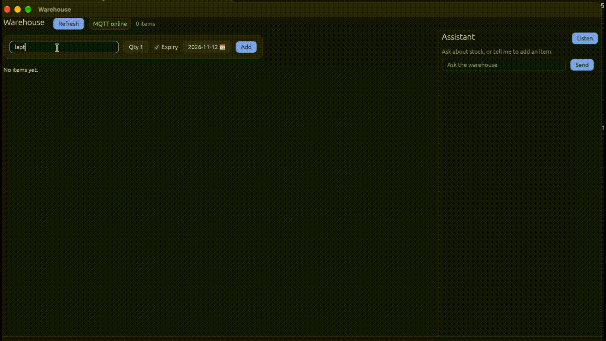

# Warehouse Item Manager API

A small REST API for warehouse inventory: create items, list them, change quantities, and delete them. A desktop egui window talks to the same REST API and listens to the same MQTT events. The window can also listen to the microphone: a local Python service turns speech into text, the existing assistant handles it, and Piper speaks the reply. The project covers a typical stack: HTTP, PostgreSQL, input validation, UI, errors, and tests.

## Stack

- Rust (stable)
- [axum](https://github.com/tokio-rs/axum) — HTTP framework
- [SQLx](https://github.com/launchbadge/sqlx) — SQL without an ORM; queries checked at compile time
- PostgreSQL 16
- tokio — async runtime
- serde / serde_json — JSON
- [rumqttc](https://github.com/bytebeamio/rumqttc) — MQTT client
- Mosquitto — message broker (in Docker)
- [egui](https://github.com/emilk/egui) / [eframe](https://github.com/emilk/egui/tree/main/crates/eframe) — desktop window
- reqwest — HTTP client for the window and Groq calls on the server
- [Vosk](https://alphacephei.com/vosk/) small English model — local speech recognition
- [Silero VAD](https://github.com/snakers4/silero-vad) — local voice activity detection
- [Piper](https://github.com/OHF-voice/piper1-gpl) `en_US-lessac-low` — local text to speech
- tower-http — log each request
- tracing / tracing-subscriber — logging
- dotenvy — read `.env`

There is no ORM (Diesel, SeaORM). Queries are plain SQL.

## One-time setup

- Rust: `brew install rustup`, then run `rustup-init` once (or `rustup default stable` if the Homebrew formula no longer ships `rustup-init`). `cargo` is the package manager and build tool, similar to `npm`.
- OrbStack (or another Docker runtime): `brew install --cask orbstack`
- Migration CLI, version aligned with sqlx in `Cargo.toml`:

```bash
cargo install sqlx-cli --no-default-features --features rustls,postgres
```

## How to run

```bash
cp .env.example .env
docker compose up -d
sqlx migrate run
cargo run
```

`cargo run` starts the API (`default-run = warehouse` in `Cargo.toml`). The event listener is a separate binary and keeps its terminal busy like the server does.

The server listens on `http://localhost:3000`. Open that URL in a browser for a page where you can add, edit, and delete items. The assistant panel has Listen / Stop next to Send: the same speech routes as the desktop window (`/voice/stream` and `/voice/tts`). The page and API share the same origin, so you do not need a separate frontend. Allow the microphone when the browser asks.

`docker compose` starts Postgres 16, Mosquitto (MQTT broker), and the voice sidecar. Postgres also creates a second database `warehouse_test` once (`docker/init-test-db.sql`). Tests use it so they do not wipe data you use manually.

The first start of the voice container downloads about 100 MB of models (Vosk 39 MB, Piper 60 MB, Silero 2 MB) into the `voice-models` volume and checks each file's sha256. Later starts reuse the volume. Watch it with `docker compose logs -f voice`. The sidecar needs about 1 GB of RAM; the compose file caps it at 1500 MB. Speech still needs `GROQ_API_KEY` for the assistant. Without the sidecar, item routes keep working and `/voice/tts` returns 503.

To print warehouse events, open a second terminal before `cargo run`:

```bash
cargo run --bin mqtt_listener
```

Create, update, and delete print the topic and JSON. Listing items does not publish events. If Mosquitto is down, the site still works: the API logs a warning and items are stored in Postgres.

Quick check:

```bash
curl -s localhost:3000/health

curl -s -X POST localhost:3000/items \
  -H 'content-type: application/json' \
  -d '{"name":"bolts","quantity":10}'
```

Stop the server with Ctrl+C. It stops accepting new requests and waits for in-flight ones to finish.

The desktop window is a separate program. Run it from the repo root so `.env` is loaded, with the API already running:

```bash
cargo run -p warehouse-desktop
```

The window reads `WAREHOUSE_API_URL` (default `http://localhost:3000`) and the same `MQTT_HOST` / `MQTT_PORT` as the server. The item list, form, and Edit / Delete buttons use REST. With Mosquitto up, a second window sees changes without pressing Refresh, and expiry reminders appear at the bottom. If the broker is down, the header shows MQTT offline; you can still create items.

The same window has an Assistant panel on the right. It works only when `GROQ_API_KEY` is set in `.env` and the API is restarted. Default model: `openai/gpt-oss-20b` (`GROQ_MODEL`). The key stays on the server: the window sends text to `POST /assistant` and never sees the key. An empty key does not break the warehouse: the server logs a warning and chat gets 503. To try the assistant, create a free API key at [Groq Console](https://console.groq.com/keys), set `GROQ_API_KEY` in `.env`, and restart `cargo run`. Do not commit the key.

Listen uses the microphone. On the desktop window, macOS asks for permission the first time; allow it for Terminal or the IDE that launches `cargo`. In the browser, allow the microphone for `http://localhost:3000`. Recognized text is sent through the same assistant as the Send button. The reply is spoken. Confirm delete and Add to existing stay on their buttons. Stop ends the microphone. While the reply plays, microphone audio is not sent, so the recognizer does not hear itself.

## Running tests

```bash
cargo test --workspace
```

- Unit tests in `warehouse-core` check validation and that item JSON round-trips into the same struct. They do not touch the database.
- Unit tests in `warehouse-desktop` cover MQTT parsing, expiry styling, and how the window applies events. `egui_kittest` draws the window: an empty name does not send a command; Send queues a phrase; assistant replies show in the panel; Confirm delete sends deletion.
- Integration tests in `tests/api.rs` hit real Postgres via `TEST_DATABASE_URL`. If the variable is missing, the test is skipped with a message instead of failing.
- `tests/assistant.rs` starts a fake Groq server on a random port. Responses are scripted, not live LLM output. Real Groq is never called. `tests/api.rs` and `tests/assistant.rs` are separate processes, so both take the same `pg_advisory_lock` before truncating the table.
- `tests/voice.rs` starts a fake speech sidecar. No test loads Vosk or Piper.
- `voice-sidecar`: `python3 -m pytest` from that directory. Those tests do not download models. Install `pytest` first (`pip install -r voice-sidecar/requirements-dev.txt`).
- Tests run migrations on the test database and clear the `items` table.
- Requests hit the router in-process without opening a port via `tower::ServiceExt::oneshot`.

Both integration test binaries share one table, so they use a lock. `cargo test --workspace` is usually enough. For strictly serial runs:

```bash
cargo test --workspace -- --test-threads=1
```

## Endpoints

| Method | Path | Description |
| --- | --- | --- |
| GET | `/` | Demo page in the browser. No database required. |
| GET | `/health` | `{"status":"ok"}`. No database required. |
| GET | `/items` | List all items, newest first. |
| GET | `/items/{id}` | One item. `404` if missing. |
| POST | `/items` | Create. `201` and the created row. |
| PUT | `/items/{id}` | Replace name and quantity. `404` if missing. |
| DELETE | `/items/{id}` | Delete. `204` with no body, or `404`. |
| POST | `/assistant` | Chat. Body: message history. Response: reply text, `changed`, optionally `pending_delete` when the model asks to delete, and optionally `pending_add` when a create matches an existing name. |
| GET | `/voice/stream` | Websocket. Client sends 16 kHz mono PCM16. Server sends JSON `speech_start`, `transcript`, or `error`. |
| POST | `/voice/tts` | Body `{"text":"..."}`. Response is `audio/wav`. |

`id` is a UUID. Request and response bodies are JSON.

Create and update body:

```json
{ "name": "bolts", "quantity": 10 }
```

Empty name (or whitespace only) and negative quantity return `400`:

```json
{ "error": "name must not be empty" }
```

Database errors return `500` with a short message. Details stay in the server log, not in the client response.

Malformed JSON (not an object, wrong types) is rejected by axum with `422`. That is request parsing, not our field validation.

`POST /assistant` body:

```json
{ "messages": [{ "role": "user", "text": "add 3 bolts" }] }
```

Response when the model changed data:

```json
{ "reply": "Added 3 bolts.", "changed": true, "pending_delete": null, "pending_add": null }
```

`changed: true` means a row was written. `pending_delete` is not deletion itself; it asks the user to press Confirm delete. The actual `DELETE` is sent by that button. `pending_add` is the same pattern for stock: if `create_item` finds a row with that name, nothing is written and the UI asks Add to existing or Create new. Those buttons call `PUT` or `POST`. If the model only replies without calling `create_item`, the server can still set `pending_add` when the last user message looks like `add N name` and that name already exists. Without an API key: `503` and `{"error":"assistant is not configured"}`. Groq failures: `502` with a generic message; details only in the server log. Empty history: `400`.

## MQTT

HTTP answers the caller. MQTT broadcasts to everyone listening. After a successful database write, the server publishes JSON to the broker (QoS 1: at-least-once delivery).

| Event | Topic | Payload |
| --- | --- | --- |
| created | `warehouse/items/created` | item JSON |
| updated | `warehouse/items/updated` | item JSON |
| deleted | `warehouse/items/deleted` | `{"id":"..."}` |

Postgres is the source of truth. The broker only relays news. Integration tests use a stub publisher that sends nothing. The desktop window subscribes to `warehouse/items/#`. `created`, `updated`, and `deleted` trigger a list refresh. `expiring` and `expired` also add a line at the bottom of the window.

## Expiry

An item may have no expiry date. In Rust that is `Option<DateTime<Utc>>`: `Some(date)` or `None`. JSON uses a date or `null`. In Postgres, `expires_at` is nullable.

The Add button does not send reminders. While `cargo run` is active, a tokio task next to the HTTP server checks deadlines every minute and publishes:

| When | Topic | Payload |
| --- | --- | --- |
| at most one day left | `warehouse/items/expiring` | item and `"hours_left": 24` |
| at most one hour left | `warehouse/items/expiring` | item and `"hours_left": 1` |
| past the date | `warehouse/items/expired` | item |

`hours_left` is a ladder step name, not a live countdown. Each step fires once (`expiry_notice` in the database). Changing the date via PUT resets the ladder.

To avoid waiting a full day, in the same terminal as `cargo run`:

```bash
EXPIRY_DAY_SECS=120 EXPIRY_HOUR_SECS=60 EXPIRY_TICK_SECS=5 cargo run
```

Create an item expiring in about 90 seconds. The listener will see “day”, then “hour”, then “expired”. Items without a date never produce these events.

## Layout

```
Cargo.toml            workspace: server, warehouse-core, warehouse-desktop
crates/warehouse-core models, field validation, MQTT topic names
crates/warehouse-desktop  egui window, HTTP client, MQTT subscription
src/main.rs           server startup, logging, Ctrl+C
src/lib.rs            router builder; used by server and tests
src/config.rs         DATABASE_URL from environment
src/db.rs             connection pool
src/error.rs          AppError and HTTP mapping
src/models.rs         re-exports Item, CreateItem, UpdateItem
src/validation.rs     re-exports field validation
src/handlers.rs       REST handlers, thin wrappers over repo
src/repo.rs           SQL and MQTT shared by REST and assistant
src/assistant.rs      POST /assistant and tool-calling loop
src/llm.rs            Groq HTTP client
src/routes.rs         route table
src/mqtt.rs           publish events to the broker
src/expiry.rs         background expiry checker
src/voice.rs          websocket and TTS proxy to the speech sidecar
src/bin/mqtt_listener.rs  subscriber that prints events
static/index.html     demo page, compiled into the binary
voice-sidecar/        Python service: Silero VAD, Vosk, Piper. Models download on first start.
mosquitto/config.conf local broker without a password
migrations/           SQLx SQL migrations
tests/api.rs          REST integration tests
tests/assistant.rs    assistant against fake Groq
docker-compose.yml    Postgres and Mosquitto
.sqlx/                query snapshots for offline builds
```

Path parameters use `/items/{id}` as required by axum 0.8. Clients use the same URL shape: `/items/550e8400-e29b-41d4-a716-446655440000`.

## Key technical decisions

### Why SQLx instead of an ORM

An ORM builds SQL from methods like `find_by_id`. That is convenient until queries get opaque and errors show up only at runtime.

SQLx keeps SQL in source. The `query_as!` macro connects to the database at build time, checks the query text and column types, and maps them onto `Item`. A typo in a column name or `TEXT` where a number is expected becomes a compile error, not a production surprise. The query stays explicit: you can paste it into `psql` and run it.

### Why a custom AppError instead of anyhow / thiserror

`anyhow` is for “some error” when the program does not care which case failed. HTTP handlers need distinct cases: not found → `404`, bad input → `400`, database → `500`. A dedicated `enum` encodes that.

`thiserror` reduces boilerplate when many variants need `Display` text. Here there are few variants and the important part is mapping each to an HTTP status—about twenty lines by hand, which also shows how `IntoResponse` works. `thiserror` would pay off if the enum grew much larger.

`From<sqlx::Error>` lets `?` in handlers turn database errors into `AppError::Database`. Clients get a generic message; the full text goes to the log.

### How compile-time SQL checking works

`query_as!` runs at `cargo build`, not per request. It needs a live database with the schema, reads `DATABASE_URL` (from the environment or `.env`), and asks Postgres whether the query is valid and what types it returns.

The trade-off: without a database the project may not build. `cargo sqlx prepare` writes snapshots to `.sqlx/`. Then you can build without Postgres:

```bash
SQLX_OFFLINE=true cargo build
```

Commit `.sqlx/`. After changing SQL, run `cargo sqlx prepare` again or offline builds drift from the code.

### Why the window uses REST, not Postgres

Validation, MQTT publication, and resetting `expiry_notice` when the date changes live in handlers. If the window opened its own pool and ran `UPDATE` directly, it would skip that logic. The browser page and the egui window are two clients of one API. One source of truth.

egui 0.37’s date picker gives a calendar day via `jiff`; the API stores `chrono::DateTime<Utc>`. The window maps the selected day to `23:59:59` UTC so the item is not marked expired the instant that calendar day starts.

### Why network I/O is not inside a frame

egui calls `App::ui` every frame and redraws the whole UI. A network call inside that path would freeze redraw until the server responds. HTTP and MQTT run on a background thread with its own tokio runtime. The window sends commands on a channel (`Refresh`, `Create`, `Update`, `Delete`, `Ask`) and drains replies with `try_recv` at the start of each frame. The worker calls `request_repaint` after a reply so egui schedules another frame. `Ask` waits up to 60 seconds; ordinary warehouse calls still time out at 10.

### Why the assistant does not write SQL or delete rows itself

The model may only call four functions: list, create, update, and request delete. Arguments deserialize into the same `CreateItem` and `UpdateItem` as REST JSON and pass `validate_item`. Bad quantity is returned to the model as a tool result, not HTTP 500. The model never sees SQL.

`delete_item` does not remove the row. The response includes `pending_delete`; the window shows Confirm delete, and only that button calls `DELETE /items/{id}`.

`create_item` does not insert when a row already uses that name (trim, case-insensitive). The response includes `pending_add`; the UI offers Add to existing (a `PUT` that adds the new quantity) or Create new (`POST`). The warehouse form Add button still inserts a new row.

The server does not store chat history. The window sends the visible transcript each time. Tool calls live inside one HTTP request. If the model requests a tool, the server runs it and returns a `role: tool` message with the matching `tool_call_id`. Groq needs that pairing to continue the dialog.

The key lives in `GROQ_API_KEY` on the server. The window never receives it. Tests override `GROQ_BASE_URL` with a local axum fake so they never hit the network. Default model: `openai/gpt-oss-20b`.

### Why speech is a separate process

Vosk, Silero, and Piper are maintained as Python libraries. The Rust API stays the only process the desktop window and the browser page talk to: it proxies the microphone websocket and the WAV download, and `POST /assistant` is unchanged. A recognized phrase becomes the same `Ask` command as a typed line. An empty `VOICE_URL` returns 503, a dead sidecar returns 502, and item routes keep working either way.

VAD runs next to the recognizer. Clients only forward PCM, so phrase boundaries stay in one place. The model files are not in git. `voice-sidecar/app/bootstrap.py` downloads them into the docker volume on first start, checks sha256, and writes a `.ready` marker. A crash mid-download leaves no marker, so the next start fetches that model again.

Piper (`piper-tts`, project piper1-gpl) is GPL-3.0-or-later. Vosk is Apache-2.0. Silero VAD is MIT. The downloaded models stay in the volume and are not committed.

### Why validation is shared but repeated on the server

`validate_item` lives in `warehouse-core`. The window calls it before sending and shows errors immediately. The server calls it again because any client can post JSON directly, including `curl`. Shared validation does not replace checks at the API boundary.

### Why MQTT on the desktop is best-effort

Like on the server, the broker only relays events; Postgres remains authoritative. If Mosquitto is unreachable, the window shows MQTT offline and keeps working over REST. The broker client id includes a fresh UUID so two open windows do not kick each other off the same id.
